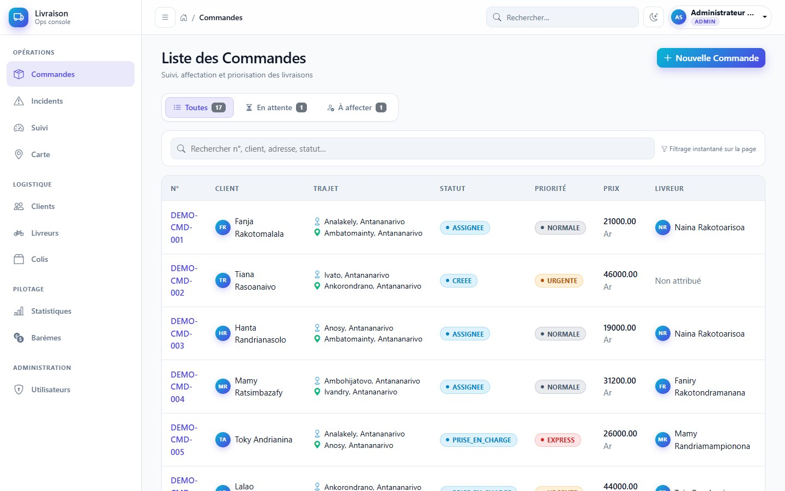
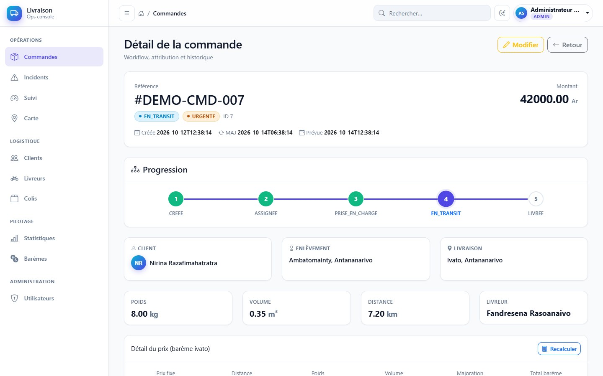
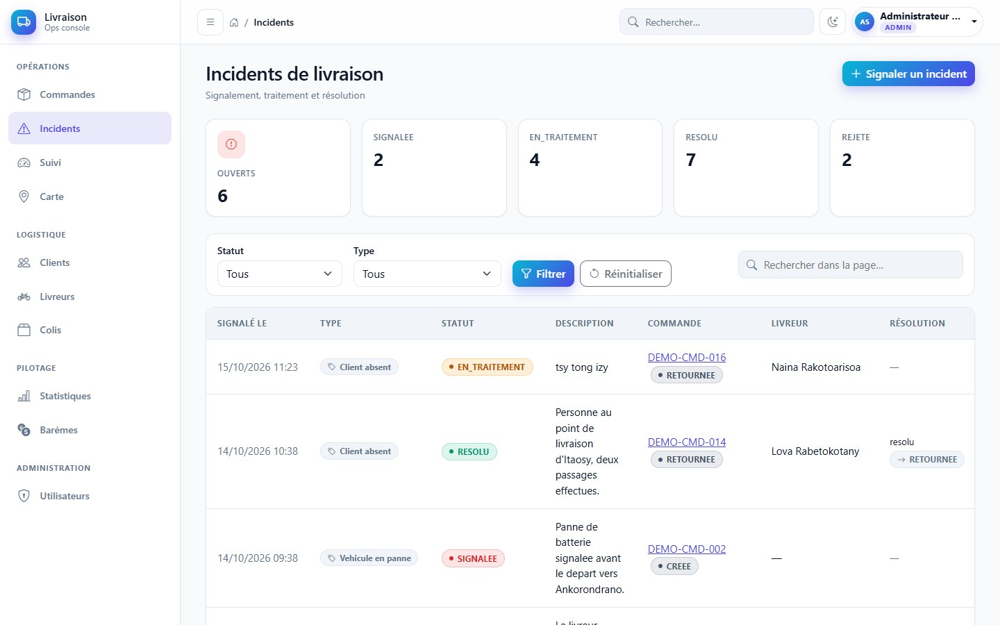
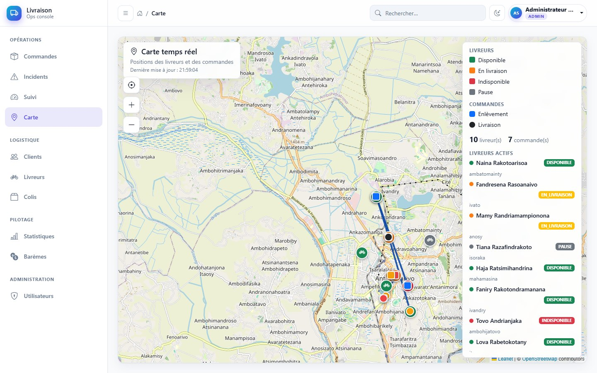
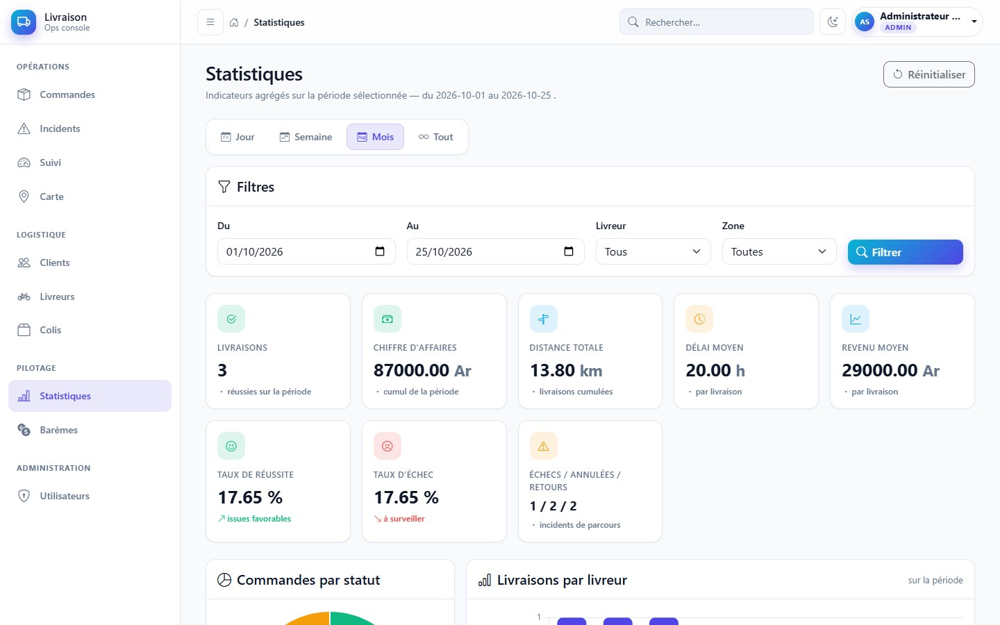
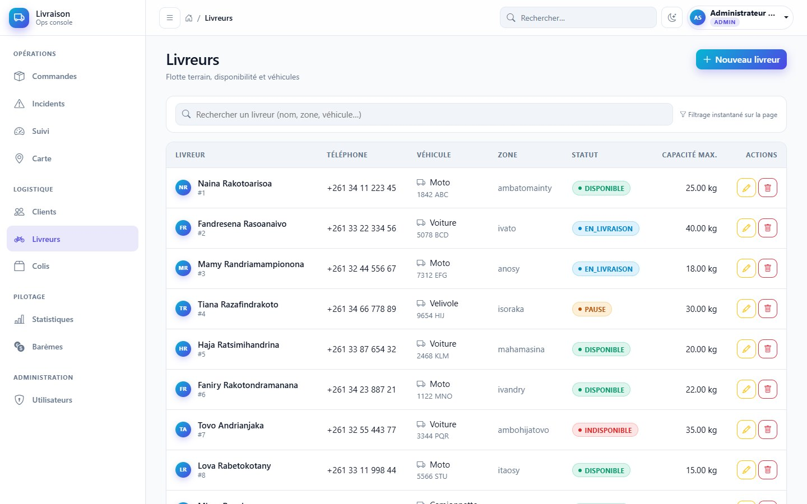
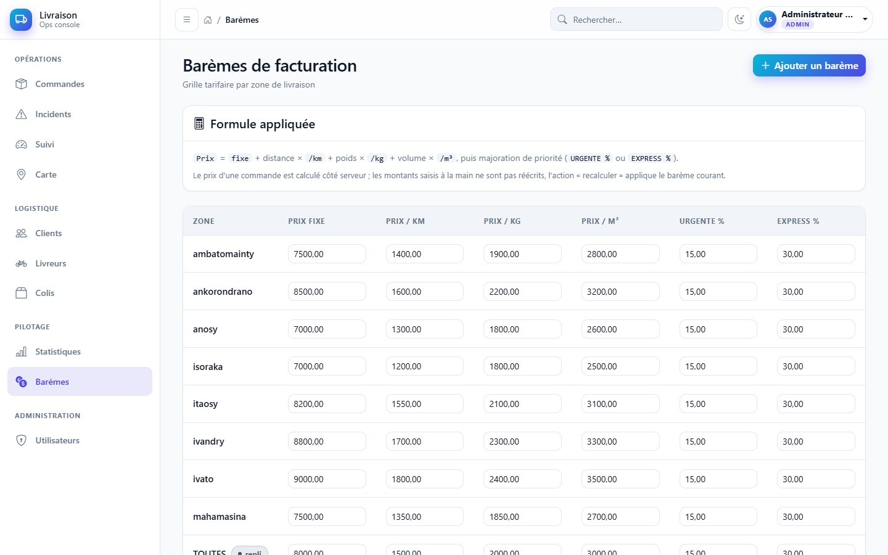

# Gestion d'un service de livraison

Application web de gestion et d'optimisation des livraisons : centralisation des commandes, des colis, des clients et des livreurs, suivi des expéditions en temps réel et attribution intelligente des tournées.


---

## Aperçu de l'interface

Captures réalisées avec le jeu de données de démonstration (`scripts/reset-demo.sql`), connecté en `ADMIN`.

<table>
  <tr>
    <td width="50%">
      
      <br><sub><b>Connexion</b> — formulaire sécurisé, redirection vers les commandes après authentification.</sub>
    </td>
    <td width="50%">
      
      <br><sub><b>Commandes</b> — filtres Toutes / En attente / À affecter, recherche instantanée, priorité et livreur.</sub>
    </td>
  </tr>
  <tr>
    <td width="50%">
      
      <br><sub><b>Détail</b> — progression du workflow, prix détaillé par barème et historique des transitions.</sub>
    </td>
    <td width="50%">
      
      <br><sub><b>Incidents</b> — compteurs par statut, filtres type/statut, résolution avec transition de commande.</sub>
    </td>
  </tr>
  <tr>
    <td width="50%">
      
      <br><sub><b>Suivi</b> — indicateurs temps réel, tournées actives, retards et temps de trajet estimés.</sub>
    </td>
    <td width="50%">
      
      <br><sub><b>Carte</b> — positions des livreurs et des commandes actives, rafraîchissement automatique.</sub>
    </td>
  </tr>
  <tr>
    <td width="50%">
      
      <br><sub><b>Statistiques</b> — période, livreur et zone ; livraisons, chiffre d'affaires et taux de réussite.</sub>
    </td>
    <td width="50%">
      
      <br><sub><b>Livreurs</b> — flotte, zones d'activité, capacités, véhicules et statuts.</sub>
    </td>
  </tr>
  <tr>
    <td width="50%">
      
      <br><sub><b>Barèmes</b> — prix fixe, prix au km/kg/m³ et majorations par priorité, par zone.</sub>
    </td>
    <td width="50%">
      <p><b>Autres écrans</b></p>
      <p><sub>Les clients, les colis et les comptes utilisateurs disposent de listes et de formulaires équivalents. Les actions visibles dépendent du rôle connecté : <code>ADMIN</code> (tout), <code>DISPATCHER</code> (exploitation) ou <code>LIVREUR</code> (commandes, suivi, incidents).</sub></p>
    </td>
  </tr>
</table>

---

## Sommaire

- [Aperçu de l'interface](#aperçu-de-linterface)
- [Aperçu](#aperçu)
- [Fonctionnalités](#fonctionnalités)
- [Stack technique](#stack-technique)
- [Prérequis](#prérequis)
- [Installation](#installation)
- [Configuration](#configuration)
- [Comptes de démonstration](#comptes-de-démonstration)
- [Données de démonstration](#données-de-démonstration)
- [API REST](#api-rest)
- [Tests](#tests)
- [Structure du projet](#structure-du-projet)
- [Rôles et permissions](#rôles-et-permissions)

---

## Aperçu

L'application couvre l'ensemble du cycle de vie d'une livraison : création d'une commande, calcul du prix selon un barème, affectation d'un livreur (manuelle ou automatique), suivi des statuts, gestion des incidents et analyse statistique de l'activité.

Le cœur métier est le **workflow de commande à 8 états**, dont les transitions sont contrôlées par `StatutWorkflowService`.

Parcours nominal :

```
CREEE ──► ASSIGNEE ──► PRISE_EN_CHARGE ──► EN_TRANSIT ──► LIVREE
```

Transitions autorisées :

| Depuis | Vers |
|---|---|
| `CREEE` | `ASSIGNEE`, `ANNULEE` |
| `ASSIGNEE` | `PRISE_EN_CHARGE`, `ANNULEE`, `ECHEC_LIVRAISON` |
| `PRISE_EN_CHARGE` | `EN_TRANSIT`, `ECHEC_LIVRAISON`, `RETOURNEE` |
| `EN_TRANSIT` | `LIVREE`, `ECHEC_LIVRAISON`, `RETOURNEE` |
| `ECHEC_LIVRAISON` | `RETOURNEE` |
| `LIVREE`, `ANNULEE`, `RETOURNEE` | — (états terminaux) |

## Fonctionnalités

### Opérations
- **Commandes** : création, modification, détail, suppression, recalcul du prix, transitions de statut contrôlées, preuve de livraison (réceptionnaire, code de confirmation, commentaire).
- **Attribution des livreurs** : affectation manuelle ou automatique par score, avec classement des candidats et justification du score.
- **Incidents** : déclaration (adresse incorrecte, colis endommagé, client absent, refus client, véhicule en panne), traitement, résolution et rejet ; la résolution peut proposer une transition appliquée à la commande.
- **Suivi** : tableau de bord avec avancement des tournées, alertes et carte Leaflet des positions des livreurs.
- **Logistique** : gestion des clients, des livreurs (zone, capacité, véhicule, statut) et des colis (poids, volume, fragile).

### Pilotage
- **Statistiques** : volumes livrés, chiffre d'affaires, répartition par livreur et par zone, filtrage par période, livreur et zone.
- **Barèmes de facturation** : prix fixe, prix au km/kg/m³ et majorations par priorité, définis par zone avec un barème `TOUTES` en repli.

### Technique
- API REST authentifiée (HTTP Basic) consommée par l'interface elle-même.
- Calcul d'itinéraires routiers via OSRM ou OpenRouteService, avec repli automatique en ligne droite si aucun fournisseur n'est joignable.
- Interface responsive (Thymeleaf + Bootstrap 5), thème clair/sombre.

### Attribution intelligente

Les livreurs éligibles (statut `DISPONIBLE`, zone compatible, capacité suffisante) sont classés par score :

```
score = 100 × (0,50 × proximité + 0,30 × charge + 0,20 × capacité) × multiplicateur de priorité
```

| Facteur | Calcul |
|---|---|
| Proximité | `1 − min(distance / 15 km, 1)` entre le livreur et le point de livraison |
| Charge | `1 / (1 + nombre de commandes actives)` |
| Capacité | `1 − min(poids total / capacité, 1)` |
| Priorité | `EXPRESS` ×1,10 · `URGENTE` ×1,05 · `NORMALE` ×1,00 |

## Stack technique

| Couche | Technologie |
|---|---|
| Langage | Java 21 |
| Framework | Spring Boot 4.1.1 (Web MVC, Data JPA, Security) |
| Vues | Thymeleaf, Bootstrap 5, Bootstrap Icons, Leaflet |
| Persistance | MySQL, Hibernate (`ddl-auto=update`) |
| Build | Maven (wrapper inclus) |
| Tests | JUnit 5, Spring Boot Test, Spring Security Test |

## Prérequis

- **JDK 21**
- **MySQL 8** (le script de démonstration évite les syntaxes récentes et reste compatible avec les versions antérieures)
- Aucune installation de Maven n'est nécessaire : le wrapper `mvnw` est fourni.

## Installation

### 1. Cloner le dépôt

```bash
git clone https://github.com/diarydiari5-beep/Gestion-d-un-service-de-livraison.git
cd Gestion-d-un-service-de-livraison
```

### 2. Créer la base de données

```sql
CREATE DATABASE livraison CHARACTER SET utf8mb4 COLLATE utf8mb4_unicode_ci;
```

Le schéma est créé automatiquement au premier démarrage par Hibernate.

### 3. Configurer la connexion

Édite `src/main/resources/application.properties` si tes identifiants MySQL diffèrent :

```properties
spring.datasource.url=jdbc:mysql://localhost:3306/livraison
spring.datasource.username=root
spring.datasource.password=
```

### 4. Lancer l'application

```bash
# Windows
mvnw.cmd spring-boot:run

# Linux / macOS
./mvnw spring-boot:run
```

L'application est disponible sur **http://localhost:8084** et redirige vers la page de connexion.

### 5. Se connecter

Utilise un compte de démonstration (voir ci-dessous) ; ils sont créés automatiquement au premier démarrage si la table `utilisateurs` est vide.

## Configuration

Toutes les valeurs sont surchargeables par variable d'environnement (syntaxe `${NOM:valeur_par_defaut}`).

| Variable | Défaut | Description |
|---|---|---|
| `SERVER_PORT` | `8084` | Port HTTP |
| `SPRING_DATASOURCE_URL` | `jdbc:mysql://localhost:3306/livraison` | URL JDBC |
| `SPRING_DATASOURCE_USERNAME` | `root` | Utilisateur MySQL |
| `SPRING_DATASOURCE_PASSWORD` | *(vide)* | Mot de passe MySQL |
| `APP_DEMO_ENABLED` | `false` | Injecte un jeu de données de démonstration au démarrage |
| `ROUTE_PROVIDER` | `osrm` | Fournisseur d'itinéraires : `osrm` ou `openrouteservice` |
| `OSRM_URL` | `https://router.project-osrm.org` | Instance OSRM |
| `ORS_URL` | `https://api.heigit.org/openrouteservice` | Instance OpenRouteService |
| `ORS_API_KEY` | *(vide)* | Clé OpenRouteService ; sans clé, repli en ligne droite |
| `ORS_PROFILE` | `driving-car` | Profil de routage ORS |
| `ROUTE_CACHE_SECONDS` | `60` | Durée de cache des itinéraires |

> Les clés d'API et les mots de passe ne doivent **jamais** être commités : passe par des variables d'environnement.

## Comptes de démonstration

Créés au premier démarrage (`ComptesInitialesConfig`) si aucun utilisateur n'existe.

| Identifiant | Mot de passe | Rôle |
|---|---|---|
| `admin` | `admin123` | `ADMIN` |
| `dispatcher` | `dispatcher123` | `DISPATCHER` |
| `livreur` | `livreur123` | `LIVREUR` |

> Ces comptes sont destinés à la démonstration. Change les mots de passe avant tout déploiement réel.

## Données de démonstration

Deux approches, à choisir selon le besoin.

### A. Jeu de données Java (rapide)

```bash
APP_DEMO_ENABLED=true mvnw.cmd spring-boot:run   # PowerShell : $env:APP_DEMO_ENABLED="true"; mvnw.cmd spring-boot:run
```

`DemoDataInitializer` insère clients, livreurs et commandes ; l'opération est ignorée si les données existent déjà.

### B. Jeu de données SQL complet (recommandé pour une démo)

`scripts/reset-demo.sql` recharge un jeu cohérent : 10 livreurs, 8 clients, **16 commandes couvrant les 8 statuts**, 16 colis, l'historique des transitions, 14 incidents (tous types et statuts) et 9 barèmes. Le script purge uniquement les données préfixées `DEMO-` / `API-`.

```bash
mysql -u root -p livraison -e "source scripts/reset-demo.sql"
```

### C. Simuler les déplacements des livreurs

`scripts/simuler-livreurs.ps1` anime la flotte : il interroge les itinéraires de l'API et publie les positions GPS à intervalle régulier, ce qui fait progresser la carte et le tableau de bord.

```powershell
# Simulation continue (2 s entre chaque pas, 30 km/h)
.\scripts\simuler-livreurs.ps1

# Un seul cycle, puis arrêt
.\scripts\simuler-livreurs.ps1 -UneSeuleFois

# Paramètres disponibles
.\scripts\simuler-livreurs.ps1 -BaseUrl "http://localhost:8084" -Utilisateur admin -MotDePasse admin123 `
    -IntervalleSecondes 2 -VitesseKmh 30 -RafraichirGeometrie 15
```

Le script s'authentifie en HTTP Basic sur l'API et s'arrête avec `Ctrl+C`.

## API REST

Toutes les routes `/api/**` exigent une authentification (HTTP Basic ou session déjà ouverte) ; CSRF est désactivé sur ce périmètre.

```bash
curl -u admin:admin123 http://localhost:8084/api/orders
```

### Commandes

| Méthode | Route | Description |
|---|---|---|
| `GET` | `/api/orders` | Liste des commandes |
| `GET` | `/api/orders/{id}` | Détail d'une commande |
| `POST` | `/api/orders` | Création |
| `POST` | `/api/orders/{id}/assign` | Affectation à un livreur |
| `POST` | `/api/orders/{id}/assign-best` | Affectation automatique (meilleur score) |
| `POST` | `/api/orders/{id}/pickup` | Prise en charge |
| `POST` | `/api/orders/{id}/start` | Départ de la tournée |
| `POST` | `/api/orders/{id}/deliver` | Livraison avec preuve |
| `POST` | `/api/orders/{id}/cancel` | Annulation |
| `POST` | `/api/orders/{id}/incidents` | Déclaration d'incident |
| `POST` | `/api/orders/{id}/recalculate-price` | Recalcul du prix |
| `GET` | `/api/orders/{id}/tracking` | Suivi de la commande |
| `GET` | `/api/orders/{id}/transitions` | Transitions autorisées |
| `GET` | `/api/orders/{id}/route` | Itinéraire |
| `GET` | `/api/orders/positions` | Positions des commandes actives |
| `GET` | `/api/deliverers/available` | Livreurs disponibles |

### Attribution et itinéraires

| Méthode | Route | Description |
|---|---|---|
| `GET` | `/api/commandes/{id}/candidats` | Livreurs classés par score |
| `POST` | `/api/commandes/{id}/assigner/{livreurId}` | Affectation à un livreur donné |
| `GET` | `/api/commandes/positions` | Positions pour la carte |
| `GET` | `/api/commandes/{id}/itineraire?vers=enlevement\|livraison` | Géométrie de l'itinéraire |

### Livreurs

| Méthode | Route | Description |
|---|---|---|
| `GET` | `/api/livreurs/positions` | Positions de tous les livreurs |
| `POST` | `/api/livreurs/{id}/position` | Mise à jour de position (`latitude`, `longitude`) |

### Incidents

| Méthode | Route | Description |
|---|---|---|
| `GET` | `/api/incidents` | Liste, filtrable par statut et type |
| `GET` | `/api/incidents/{id}` | Détail |
| `GET` | `/api/incidents/commande/{commandeId}` | Incidents d'une commande |
| `GET` | `/api/incidents/livreur/{livreurId}` | Incidents d'un livreur |
| `GET` | `/api/incidents/stats` | Répartition par statut et type |
| `POST` | `/api/incidents` | Déclaration |
| `POST` | `/api/incidents/{id}/traiter` | Passage en traitement |
| `POST` | `/api/incidents/{id}/resoudre` | Résolution |
| `POST` | `/api/incidents/{id}/rejeter` | Rejet |
| `POST` | `/api/incidents/{id}/delete` | Suppression |
| `GET` | `/api/incidents/{id}/transitions` | Transitions autorisées |
| `GET` | `/api/incidents/statuts` · `/types` | Référentiels |

### Statistiques

| Méthode | Route | Description |
|---|---|---|
| `GET` | `/api/statistics/deliveries` | Volumes et répartition des livraisons |
| `GET` | `/api/statistics/revenue` | Chiffre d'affaires |

## Tests

```bash
mvnw.cmd test        # Windows
./mvnw test          # Linux / macOS
```

146 tests JUnit couvrent les services métier (attribution, workflow, prix, incidents, statistiques, itinéraires), la sécurité et le suivi. Les tests annotés `@SpringBootTest` démarrent le contexte applicatif et nécessitent donc une base MySQL accessible.

## Structure du projet

```
livraison/
├── pom.xml
├── mvnw / mvnw.cmd              # wrapper Maven
├── docs/screenshots/            # captures d'écran utilisées par le README
├── scripts/
│   ├── reset-demo.sql           # jeu de données de démonstration
│   └── simuler-livreurs.ps1     # simulation GPS de la flotte
└── src/
    ├── main/
    │   ├── java/com/livraison/
    │   │   ├── config/          # sécurité, comptes initiaux, modèle global
    │   │   ├── controller/      # vues Thymeleaf + API REST
    │   │   ├── dto/             # objets d'échange et de scoring
    │   │   ├── entity/          # entités JPA, embeddables, énumérations
    │   │   ├── exception/       # transitions et preuves invalides
    │   │   ├── repository/      # Spring Data JPA
    │   │   └── service/         # règles métier (workflow, prix, routage…)
    │   └── resources/
    │       ├── application.properties
    │       ├── static/          # CSS et JavaScript
    │       └── templates/       # vues Thymeleaf
    └── test/java/com/livraison/ # tests unitaires et d'intégration
```

## Rôles et permissions

| Rôle | Périmètre |
|---|---|
| `ADMIN` | Tout, y compris barèmes et gestion des comptes utilisateurs |
| `DISPATCHER` | Exploitation : clients, livreurs, colis, affectations, statistiques |
| `LIVREUR` | Commandes, suivi et incidents (pas de configuration) |

L'interface masque les entrées de menu non autorisées et le serveur applique les mêmes règles (`SecurityConfig`).

---

Projet académique — Java 21 / Spring Boot 4.1.1.
